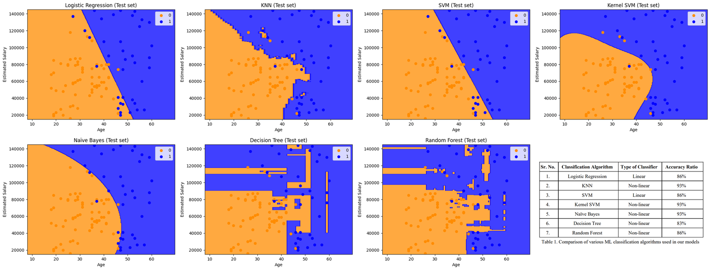

# Car Purchase Prediction using Machine Learning

A binary classification project: Given a customer's **age** and **estimated salary**, predict whether they will buy a newly
launched SUV, so that an advertising campaign can target only the likely buyers. Seven classifiers are implemented, compared
on a held-out test set and re-checked with repeated cross-validation. Built as a team project for the ML Capstone course at
Thakur College of Engineering & Technology (TCET), A.Y. 2023-24.

## Highlights
- **Seven classifiers compared:** Logistic Regression, KNN, linear SVM, RBF Kernel SVM, Naive Bayes, Decision Tree, Random Forest.
- **Best models:** RBF Kernel SVM, KNN and Naive Bayes tie at **93% test accuracy** (majority-class baseline: 63%). Kernel SVM has the
  highest recall (97.3%) and F1 (0.911) on the test set, and also ranks first in 5-fold x 10 cross-validation (**91.0% +/- 2.2**).
- **Non-linear beats linear:** the four best non-linear models are about 4-7 points more accurate than the linear ones in cross-validation.
- **From scratch:** Logistic Regression, KNN and linear SVM are also implemented in plain NumPy and agree with scikit-learn on
  98-100% of test predictions.

## Data and method
400 customers, two features (`Age`, `EstimatedSalary`), target `Purchased` (35.75% buyers). See [`data/README.md`](data/README.md).

1. Exploratory analysis: summary statistics, scatter/pair plots, box plots, correlation.
2. 75/25 train/test split (`random_state = 42`): 300 training and 100 test rows (37 buyers in the test set).
3. Standardization (`StandardScaler`) fitted on the training set only, to avoid leakage.
4. Seven classifiers with these settings: KNN k = 5 (Euclidean), SVM kernels `linear` and `rbf`, entropy criterion for the Decision Tree and Random Forest (10 trees), Gaussian Naive Bayes.
5. Evaluation: confusion matrix, accuracy, precision, recall and F1 on the test set; then repeated stratified cross-validation.

## Results

### Test set (100 customers)
| Model | Accuracy | Precision | Recall | F1 |
|---|---|---|---|---|
| Logistic Regression | 0.86 | 0.926 | 0.676 | 0.781 |
| KNN (k = 5) | **0.93** | 0.895 | 0.919 | 0.907 |
| SVM (linear) | 0.86 | 0.926 | 0.676 | 0.781 |
| **Kernel SVM (RBF)** | **0.93** | 0.857 | **0.973** | **0.911** |
| Naive Bayes | **0.93** | **0.941** | 0.865 | 0.901 |
| Decision Tree | 0.83 | 0.778 | 0.757 | 0.767 |
| Random Forest (10 trees) | 0.86 | 0.811 | 0.811 | 0.811 |

Confusion-matrix counts for every model are in [`results/metrics.md`](results/metrics.md). Re-running the models with
scikit-learn 1.8.0 on the original split reproduced every confusion matrix from the original notebook run.



### Cross-validation (5 folds x 10 repeats, all 400 customers)
| Model | Accuracy | Recall | F1 |
|---|---|---|---|
| Logistic Regression | 84.6% +/- 3.5 | 0.709 | 0.765 |
| KNN (k = 5) | 89.9% +/- 2.8 | 0.869 | 0.860 |
| SVM (linear) | 83.7% +/- 3.5 | 0.678 | 0.746 |
| **Kernel SVM (RBF)** | **91.0% +/- 2.2** | **0.913** | **0.878** |
| Naive Bayes | 88.8% +/- 2.5 | 0.816 | 0.838 |
| Decision Tree | 86.6% +/- 3.6 | 0.813 | 0.811 |
| Random Forest (10 trees) | 88.8% +/- 3.0 | 0.841 | 0.842 |

Full table with precision and standard deviations: [`results/cv_results.md`](results/cv_results.md).

### What the results show
- **Non-linear models fit this data better.** The purchase region is not separable by a straight line (see the curved Kernel SVM and Naive
  Bayes boundaries above), and the linear models are the weakest in both evaluations. In cross-validation, RBF Kernel SVM, KNN, Naive Bayes and
  Random Forest are about 4-7 points more accurate than Logistic Regression and the linear SVM.
- **Kernel SVM is the best overall, but not by a wide margin.** It leads in cross-validation accuracy, recall and F1, and ties for first on the
  test set. Its lead over KNN in cross-validation (about 1 point) is smaller than the fold-to-fold standard deviation (2-3 points), so the top
  four models should not be treated as clearly separable.
- **The single test set is a noisy yardstick.** With 100 test rows, one customer is one percentage point, and a 93/100 result has a 95% interval of roughly
  86-97%. The cross-validated 91.0% is a steadier estimate for the best model.
- **Different models make different mistakes.** Kernel SVM misses almost no buyers (1 false negative) but flags more non-buyers (6 false positives); Naive
  Bayes is the reverse (5 false negatives, 2 false positives). For ad targeting, the better choice depends on the cost of a wasted ad compared with a missed buyer.
- **The unconstrained Decision Tree overfits:** its boundary is fragmented and it has the lowest test accuracy.

### From-scratch implementations vs. scikit-learn
`src/scratch_vs_sklearn.py` evaluates the NumPy implementations on the full test set:

| Model | From scratch | scikit-learn | Prediction agreement |
|---|---|---|---|
| Logistic Regression | 0.88 | 0.86 | 98% |
| KNN (k = 5) | 0.93 | 0.93 | 100% |
| SVM (linear) | 0.87 | 0.86 | 99% |

## Limitations
- Only two features and 400 rows, from a teaching dataset; the results say nothing about real-world campaign performance.
- Hyperparameters were not tuned (k = 5, 10 trees, default C and gamma); a grid search with cross-validation is a natural next step.
- The notebook reports one train/test split; the cross-validation above was added to check how stable the ranking is.
- Differences among the top models are within the noise of this small dataset.

## Run it
```bash
python -m venv .venv
.venv\Scripts\activate             # macOS/Linux: source .venv/bin/activate
pip install -r requirements.txt

python src/evaluate_models.py      # test-set metrics     -> results/metrics.*
python src/cross_validation.py     # 5x10 cross-validation -> results/cv_results.*
python src/scratch_vs_sklearn.py   # NumPy vs scikit-learn
jupyter notebook Car_Purchase_Prediction_using_ML.ipynb   # Full walkthrough with plots
```

## Repository structure
```
Car_Purchase_Prediction_using_ML.ipynb   exploratory analysis, 7 models, plots and evaluation
src/                                     scripts to reproduce the tables (evaluate_models, cross_validation, scratch_vs_sklearn)
data/README.md                           dataset description and where to place the CSV
results/                                 metrics tables (test set, cross-validation, scratch vs scikit-learn)
images/                                  decision-boundary and EDA figures
```

## Credits
Dataset: `Social_Network_Ads.csv`, a public teaching dataset (see `data/README.md`). Libraries: scikit-learn
(Pedregosa et al., JMLR 2011), NumPy, pandas, matplotlib, seaborn. The from-scratch implementations follow standard
textbook formulations of each algorithm.
